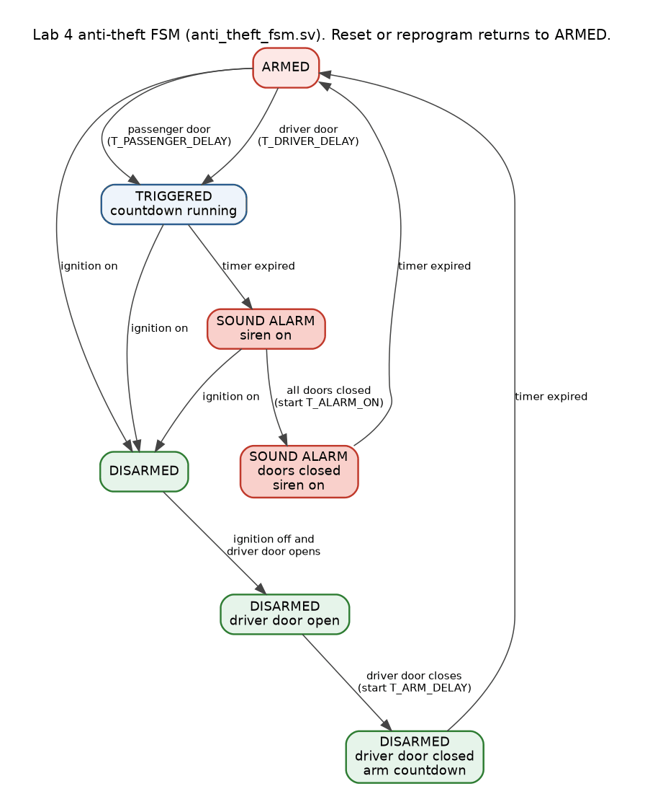

# digital_systems: MIT 6.111 Introductory Digital Systems Laboratory, fall 2021

My labs and problem sets from MIT **6.111**, the FPGA digital design lab. Everything is SystemVerilog in **Vivado** for the **Digilent Nexys 4 DDR** board (Xilinx Artix-7 `xc7a100tcsg324-3`), with one Vivado project per lab. The folder covers September 11 to October 29, 2021: labs 0–5 and the problem sets. There is no final project in this folder.

| Lab 3: Pong on VGA (RTL simulation) | Lab 5: FIR filter, designed vs. RTL |
|---|---|
|  |  |

| Lab 4: car-alarm FSM | Lab 2.5: UART frame |
|---|---|
|  |  |

> **About the pictures.** The Pong frames, waveforms, FIR response and 7-segment digits were produced by simulating the actual lab RTL in this repo with open-source tools (`tools/sim/`, see below), not drawn by hand. The waveform screenshots in [`psets/`](psets) are from my original Vivado simulations. No photos of the board running were kept.

## Labs

| Lab | Folder | What it does |
|---|---|---|
| 0 | [`lab00_io_demo`](lab00_io_demo) | Course-provided I/O demo: switches → LEDs, buttons → RGB LEDs |
| 1 | [`lab01_combinational_logic`](lab01_combinational_logic) | First combinational logic on switches → LEDs |
| 1.5 | [`lab01_5_seven_seg_decoder`](lab01_5_seven_seg_decoder) | Binary to 7-segment hex decoder, with a testbench |
| 2 | [`lab02_counters_seven_seg`](lab02_counters_seven_seg) | Debouncer, edge detector, counters, 8-digit multiplexed 7-segment driver |
| 2.5 | [`lab02_5_uart_tx`](lab02_5_uart_tx) | UART transmitter (115 200 baud) to a Python script on the PC |
| 3 | [`lab03_pong_vga`](lab03_pong_vga) | Pong on 1024 × 768 VGA: two paddles, an image puck from ROM, alpha blending |
| 4 | [`lab04_car_alarm`](lab04_car_alarm) | Car anti-theft system: 7-state FSM, programmable timers, fuel-pump cutoff, siren, VGA status |
| 5 | [`lab05_audio_recorder`](lab05_audio_recorder) | Audio recorder: XADC mic input, BRAM record and playback, 31-tap FIR, echo, PWM audio |

Problem-set designs are in [`psets/`](psets): TMDS/HDMI encoding, CRC, a convolutional FEC encoder, an interleaver, and a DRAM timing controller.

## Recreating a lab on the board

**You need:** a Nexys 4 DDR (or Nexys A7-100T, which has the same pinout), a micro-USB cable, and **Vivado**. The projects were saved with **Vivado 2019.2**; any later version opens them after an automatic project and IP upgrade. Labs 3 and 4 also need a VGA monitor, and lab 5 needs headphones plus a microphone on the XADC header (`vauxp3/vauxn3`).

1. Open the lab's project, for example `lab03_pong_vga/fpga/lab3/Lab3.xpr`.
2. If Vivado reports locked IP, run **Reports → Report IP Status → Upgrade Selected**. Then right-click each IP under *Design Sources* and choose **Generate Output Products**. The IP output files are not stored in git, only the `.xci` settings and memory files.
3. **Generate Bitstream**, open **Hardware Manager**, **Auto Connect**, then **Program Device**.
4. Use the switch and button maps in each lab's README.

To simulate in Vivado instead, set a testbench from the project's `*.srcs/sim_1/` as the simulation top and run **Behavioral Simulation**.

## Recreating the figures without Vivado

`tools/sim/` runs the same RTL in open-source simulators, so you can check the designs without a board or a Vivado license:

```bash
sudo apt install iverilog verilator graphviz    # Verilator 5.x is needed for --binary --timing
pip install pillow numpy matplotlib
tools/sim/lab01_5/run.sh    # 7-segment decoder, all 16 inputs  → docs/images/lab01_5_seven_seg.png
tools/sim/lab02/run.sh      # debouncer and UART transmitter waveforms
tools/sim/lab03/run.sh      # Pong frame (PNG) and animation (GIF) rendered from the RTL (~2 min)
tools/sim/lab04/run.sh      # car-alarm state diagram
tools/sim/lab05/run.sh      # FIR frequency response measured on the RTL
```

The Lab 3 script substitutes simple behavioral models (`tools/sim/lab03/roms.sv`) for the Vivado block-RAM IPs. They load the same `.mif` memory images that Vivado generated.

## Layout

```
digital_systems/
├── labNN_<name>/
│   ├── fpga/<lab>/        Vivado project (.xpr + .srcs)
│   ├── docs/              printed code PDF submitted for the lab (labs 2–5)
│   └── software/          host-side scripts (lab 2.5)
├── psets/
│   ├── fpga/<pset>/       Vivado projects for the problem-set designs
│   └── docs/              problem-set write-ups (PDF)
├── docs/
│   ├── images/            figures used in the READMEs
│   └── reference/         Nexys 4 DDR master constraints file
└── tools/sim/             open-source simulation scripts that produce the figures
```

Vivado's generated folders (`.cache`, `.runs`, `.sim`, `.hw`, `.ip_user_files`, `.Xil`) and IP output products are git-ignored; Vivado rebuilds them. Lab 0 and some starter modules (`xvga`, `display_8hex`, the testbench skeletons, the Lab 2.5 Python reader) are course-provided by the 6.111 staff. See [docs/STRUCTURE.md](docs/STRUCTURE.md) for the folder conventions shared across my projects.
