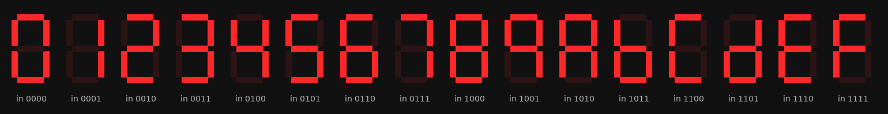

# Lab 1.5: binary to seven-segment decoder

A combinational decoder (`binary_to_seven_seg.sv`) from a 4-bit value to the seven segment lines of a hex digit, shown on one digit of the Nexys 4 display.

All 16 input codes run through the decoder RTL with Icarus Verilog (`tools/sim/lab01_5/run.sh`). Bit 0 is segment a, bit 6 is segment g.

`binhex_tb.sv` steps through all 16 inputs and prints each output pattern. The board's segment lines are active-low, so the top level inverts the decoder output (`assign {cg,…,ca} = ~led_out`).

## Recreate

1. Open `fpga/lab1_5/project_1/project_1.xpr` and program the board.
2. Set `sw[3:0]` to a 4-bit value and read it as a hex digit.
3. Simulate with `binhex_tb`, or without Vivado: `tools/sim/lab01_5/run.sh`.

_Part of [digital_systems](../README.md), MIT 6.111, fall 2021. Board: Nexys 4 DDR. Tool: Vivado 2019.2._
