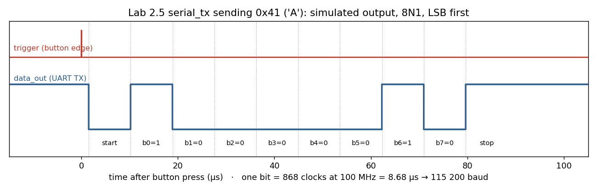

# Lab 2.5: UART transmitter

Pressing the centre button sends the byte on `sw[7:0]` to the PC over the board's USB-UART bridge.

`serial_tx.sv` sending 0x41 ('A'), simulated with Icarus Verilog (`tools/sim/lab02/run.sh`).

- `serial_tx.sv` is an 8N1 transmitter at 115 200 baud: `DIVISOR = 868` clocks per bit at 100 MHz. A 10-bit shift register holds {stop, data, start}.
- `debounce.sv` plus an edge detector make one press send exactly one byte.
- `software/uart_rx/uart.py` is the course's Python reader. It finds the Digilent port and prints each byte as ASCII and as a number.

## Recreate

1. Open `fpga/lab2_5/Lab2.5.xpr` and program the board.
2. On the PC: `pip install pyserial`, then `python software/uart_rx/uart.py`.
3. Set `sw[7:0]` (for example `01000001`), press `btnc` and see `ASCII: A, Value: 65`. `btnd` resets.

Two quirks show up in simulation:
- Right after reset the transmitter shifts out ten 0 bits, so the PC may see one 0x00 byte at power-up.
- The first bit starts at the next bit-timer boundary rather than exactly at the button press. That doesn't matter for an asynchronous UART.

_Part of [digital_systems](../README.md), MIT 6.111, fall 2021. Board: Nexys 4 DDR. Tool: Vivado 2019.2._
