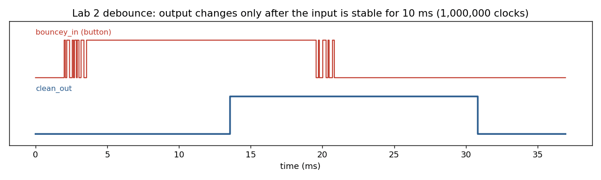

# Lab 2: debouncing, counters and the 7-segment display

Builds the reusable sequential blocks used in every later lab, all on the 100 MHz clock:

| Module | Role |
|---|---|
| `debounce.sv` | The output follows the button only after the input has been stable for 1,000,000 clocks (10 ms) |
| `edge_detector.sv` | One-cycle pulse on a rising edge |
| `simple_counter.sv` | Counts input events |
| `multiplexer.sv` | Picks what to show: the switches by default, the debounced press count of `btnu` while `btnl` is held, or a 10 Hz free-running count while `btnc` is held |
| `seven_seg_controller.sv` | Time-multiplexes 8 hex digits onto the shared cathode lines |

The debouncer RTL driven by a simulated bouncy button (Icarus Verilog, `tools/sim/lab02/run.sh`). Bounces shorter than 10 ms never reach `clean_out`.

## Recreate

1. Open `fpga/lab2/Lab2.xpr` and program the board.
2. `btnd` resets. Press `btnu` and hold `btnl` to see the press count; hold `btnc` to see the 10 Hz counter.
3. Testbenches `debounce_tb` and `simple_counter_tb` are in `sim_1`. The printed code is in `docs/Lab2_Code.pdf`.

_Part of [digital_systems](../README.md), MIT 6.111, fall 2021. Board: Nexys 4 DDR. Tool: Vivado 2019.2._
