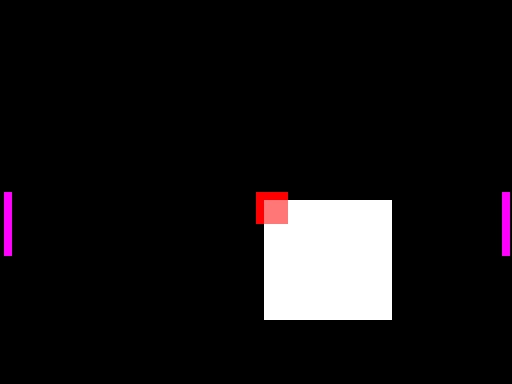
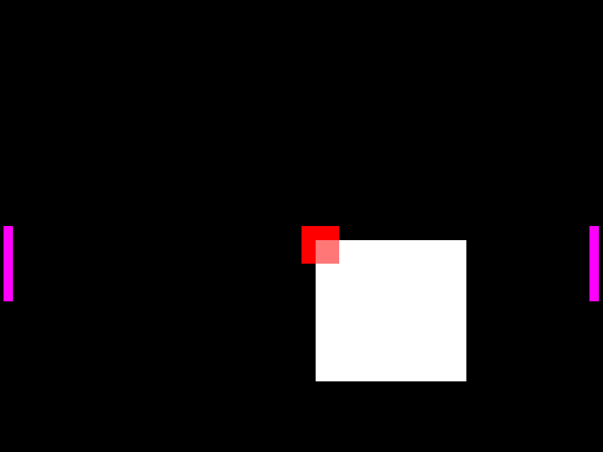
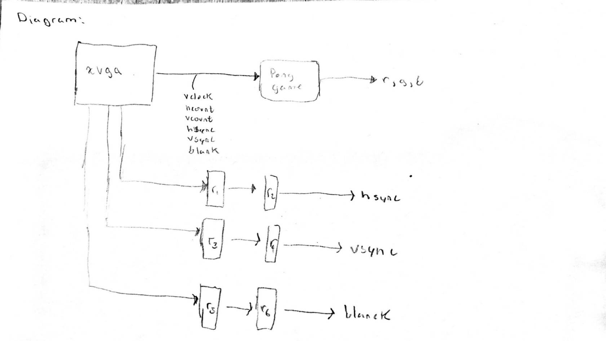

# Lab 3: Pong on VGA

A two-player Pong game drawn to a 1024 × 768 VGA monitor at 60 Hz. A clocking wizard makes the 65 MHz pixel clock.

| Animation (RTL simulation) | One frame, alpha blending at 50 % |
|---|---|
|  |  |

Both images come from simulating this lab's `pong_game`, `xvga` and `rect` modules with Verilator (`tools/sim/lab03/run.sh`). They show the puck (plain-square mode), the red centre block it alpha-blends over, and the two magenta paddles. With `sw[8]` on, the puck is drawn from the image ROM instead.

| Switches | Function |
|---|---|
| `sw[1:0]` | Mode: `00`/`11` Pong, `01` 1-pixel white outline of the screen, `10` colour bars |
| `sw[8]` | Puck drawn from the 256 × 240 image ROM (greyscale through a colour-map ROM) or as a plain white square |
| `sw[11:9]` | Alpha blend where the puck overlaps the centre block: 0, ¼, ½, ¾ or full puck |
| `sw[15:12]` | Puck speed, in pixels per frame (0 ends the game) |

Buttons: `btnu`/`btnd` move the left paddle, `btnl`/`btnr` move the right paddle, `btnc` resets. The 8-digit display shows a counter that ticks every 0.1 s.

| Module | Role |
|---|---|
| `top_level.sv` | Mode select, `xvga` timing (1344 × 806 total pixels), `display_8hex`, button debouncers, and `pong_game`, which handles puck motion, bounces off walls and paddles, and alpha blending |
| `rect.sv` | Draws a solid rectangle (paddles, puck, centre block) |
| `picture_blob.sv` | Draws the puck from `image_rom` (8-bit pixels) and `red_coe` (colour map), both block-RAM IPs |
| `blob.sv`, `circle.sv` | Scratch work for the problem set 9 pipelining question. Vivado has them auto-disabled and they aren't part of the build. |

My problem set 9 sketch of pipelining the `xvga` sync signals to line up with this lab's pixel pipeline.

## Recreate

1. Open `fpga/lab3/Lab3.xpr`. Generate output products for `image_rom`, `red_coe` and `blk_mem_gen_0`; they initialise from `fpga/lab3/coe/*.coe`.
2. Generate the bitstream, program the board, and plug in a VGA monitor.
3. To render frames without Vivado, run `tools/sim/lab03/run.sh` (add `IMG=1` to draw the image puck).

**Repairs made when this repo was assembled (October 2026).** The project as last saved in 2021 did not build. While answering problem set 9, I reworked `blob.sv` and renamed the rectangle module to `rect` in `top_level.sv`, but never added a `rect` module back. I added `Lab3.srcs/sources_1/new/rect.sv`, which is the `blob` module from the submitted code in `docs/Lab3_Code.pdf`, and listed it in the project. The two `.coe` image files lived outside the project folder and were missing, so I rebuilt them in `fpga/lab3/coe/` from the `.mif` memory images Vivado had generated, and pointed the IPs at them. The frames above were rendered from this repaired version. The 2021 bitstream predates the problem set 9 edit.

The printed code is in `docs/Lab3_Code.pdf`.

_Part of [digital_systems](../README.md), MIT 6.111, fall 2021. Board: Nexys 4 DDR. Tool: Vivado 2019.2._
