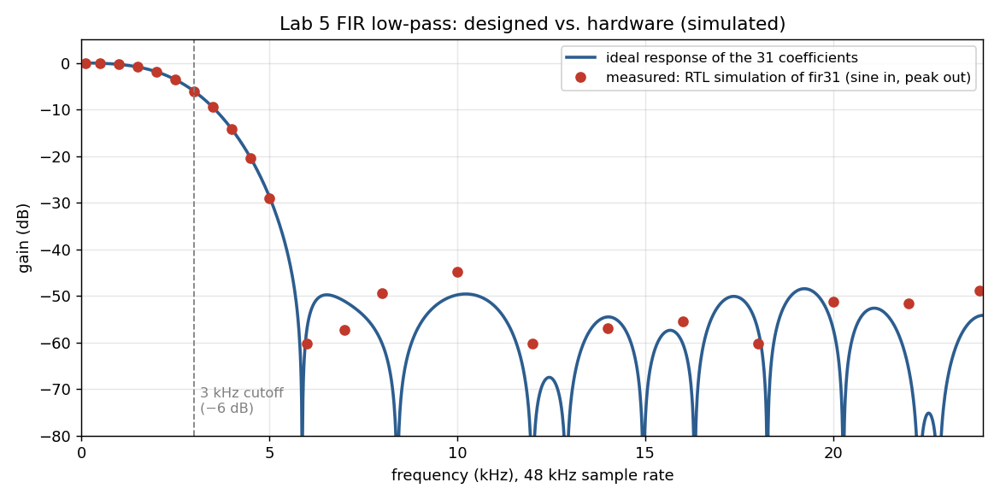

# Lab 5: audio recorder with FIR filter and echo

A voice recorder that uses the FPGA's on-chip ADC (**XADC**, auxiliary input `vauxp3/vauxn3` on the JXADC header) for the microphone and the board's mono **PWM audio** jack for output.

The `fir31` RTL measured in simulation with sine inputs at 48 kHz (red), against the ideal response of its coefficients (blue). It reaches −6 dB at the designed 3 kHz cutoff. The measured stop-band sits around −50 dB because the input is only 8 bits. Produced by `tools/sim/lab05/run.sh`.

## Signal path

1. **Sampling:** the XADC is read at about 48 kHz (`SAMPLE_COUNT = 2082` at 100 MHz) and converted from offset binary to signed 8-bit.
2. **Filter** (`sw[0]`): `fir31` is a 31-tap low-pass FIR. The coefficients are `round(fir1(30, 0.125) * 1024)` (3 kHz cutoff at 48 kHz), computed with one multiply-accumulate per clock between samples. It's used as the anti-alias filter when recording and as a smoothing filter on playback.
3. **Record** (hold `btnc`): every 8th sample is stored, giving about 6 kHz, in block RAM. That's up to 64,000 samples, about 10.7 s.
4. **Echo** (`sw[1]`): the recording is written to three BRAMs that are read 0, 6,000 and 12,000 samples apart (0, 1 and 2 s) and mixed as 1 + ½ + ¼.
5. **Output:** volume (`sw[15:13]`, implemented as arithmetic shifts), then an 8-bit PWM on `aud_pwm`.

## Recreate

1. Open `fpga/lab5/Lab5.xpr` and generate output products for the `xadc_wiz_0` and `blk_mem_gen_*` IPs.
2. Program the board. Plug headphones into the audio jack and a microphone with a preamp, biased to mid-supply, into JXADC `vauxp3/vauxn3`.
3. Hold `btnc` and speak, release to play back, and flip `sw[0]` (filter) and `sw[1]` (echo). `btnd` resets.
4. Testbenches `fir_31_tb` and `recorder_tb` (with impulse and waveform input files) are in `sim_1`. The open-source response measurement is in `tools/sim/lab05`.

Quirk: the MAC loop in `fir31` stops at index 30 before adding the last product, so only 30 of the 31 taps are used. The last coefficient is −1/1024, so the effect is negligible, as the plot shows.

The printed code is in `docs/Lab5_Code.pdf`.

_Part of [digital_systems](../README.md), MIT 6.111, fall 2021. Board: Nexys 4 DDR. Tool: Vivado 2019.2._
