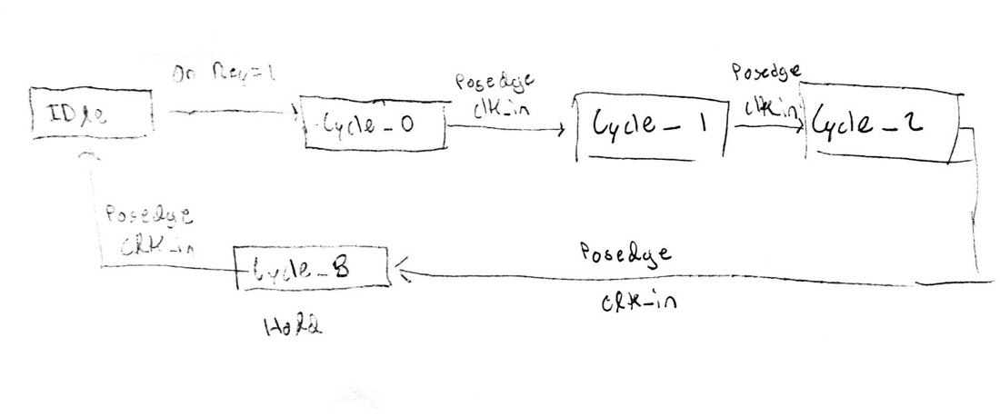
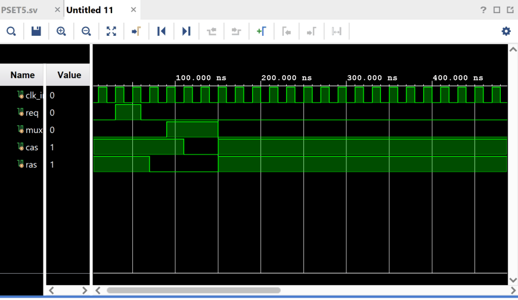
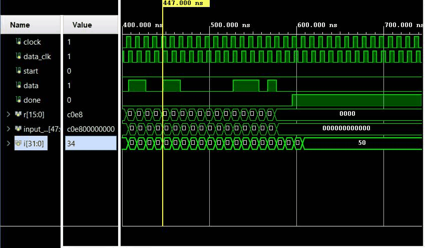
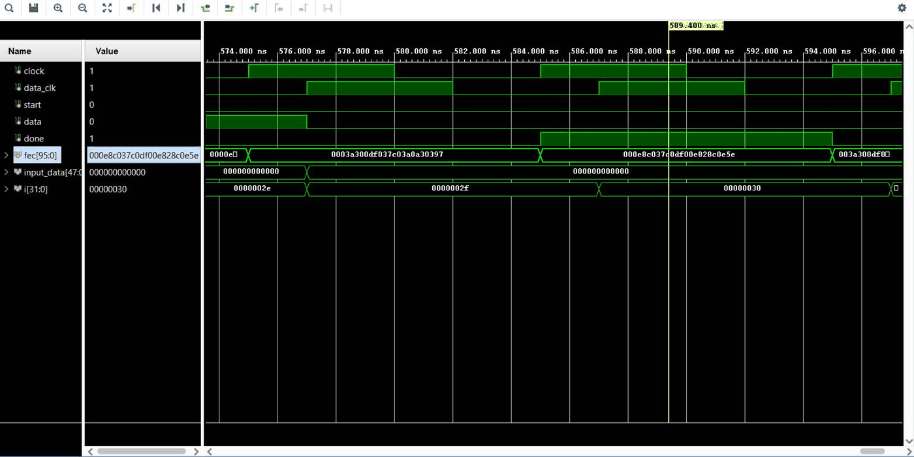
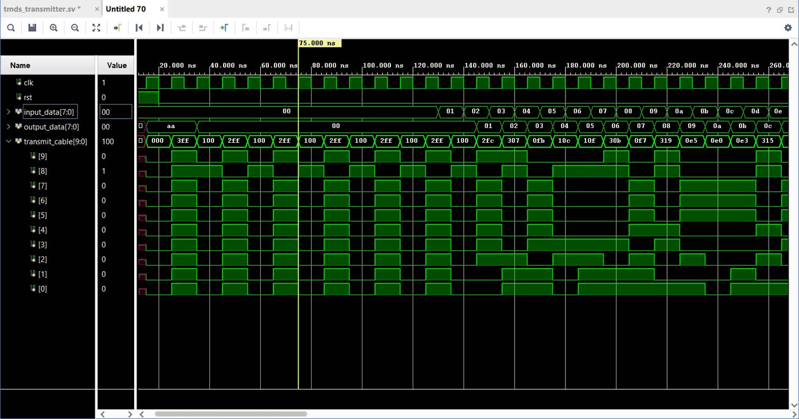

# 6.111 problem sets

Write-ups are in `docs/` (`pset01.pdf` … `pset11.pdf`), and the designs that needed Vivado are in `fpga/`. The waveforms below are screenshots from my original Vivado simulations, taken from the write-ups.

| Folder | Design |
|---|---|
| `fpga/pset02_endian` | `endian.sv` bit-order selector and the `total_system.v` structural exercise (PSET 2) |
| `fpga/all_psets` | PSET 3 edge-to-pulse generator, PSET 5 DRAM RAS/CAS/mux timing FSM, PSET 7 byte interleaver, with testbenches |
| `fpga/tmds_stage1` | First stage of TMDS (HDMI/DVI) encoding: the transition-minimising 8 → 9 bit step |
| `fpga/tmds_full` | Fuller TMDS exercise built on stage 1, handling the 10-bit symbol (`tmds_transmitter.sv`, with a testbench) |
| `fpga/crc` | Bit-serial 16-bit CRC over a 48-bit message (register preset to `FFFF`) |
| `fpga/crc_fec` | CRC plus a rate-½ convolutional FEC encoder: a 3-bit shift register, two parity bits per input bit, 48 data bits → 96 coded bits, with testbenches |

| PSET 5: DRAM controller FSM (sketch) | PSET 5: RAS/CAS/MUX timing |
|---|---|
|  |  |

| PSET 8: serial CRC | PSET 11: convolutional FEC |
|---|---|
|  |  |

PSET 9: TMDS transmitter simulation.

## Recreate

Open any `.xpr` in Vivado and run **Behavioral Simulation** on the testbench in its `sim_1` folder. None of these needs the board.

_Part of [digital_systems](../README.md), MIT 6.111, fall 2021. Board: Nexys 4 DDR. Tool: Vivado 2019.2._
